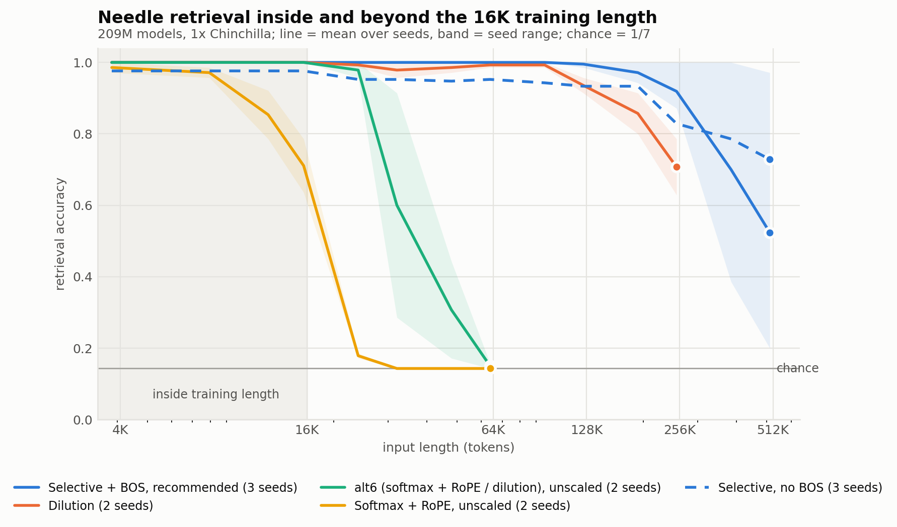
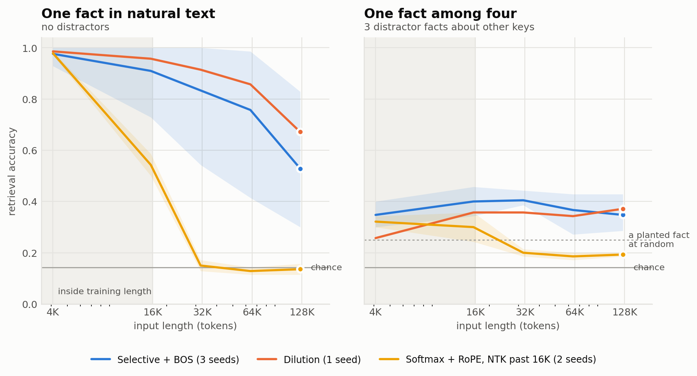
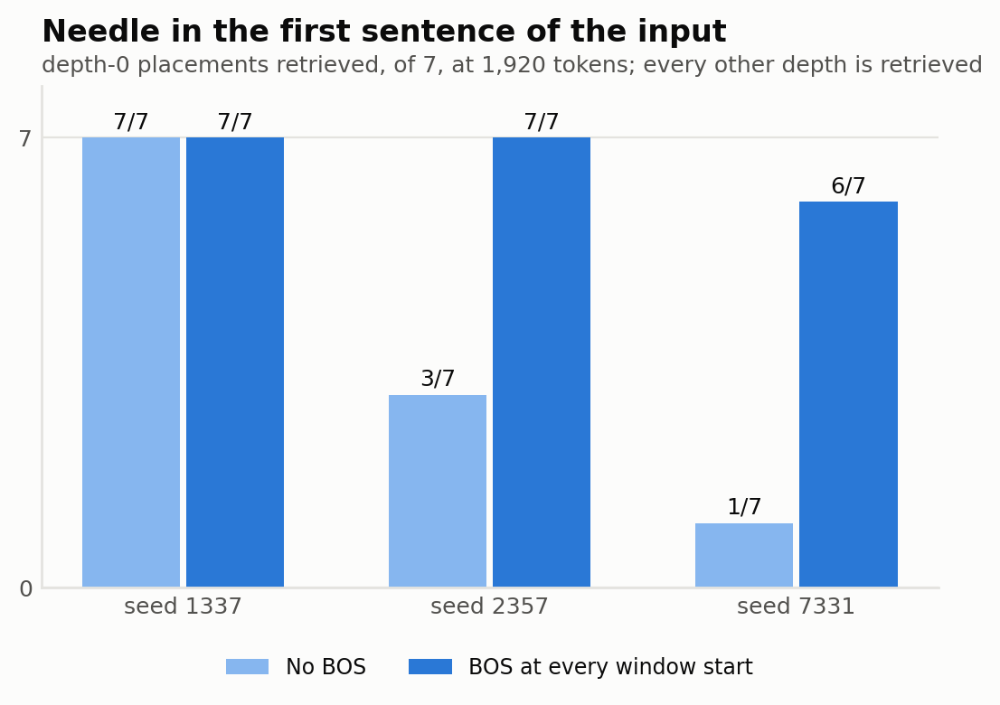
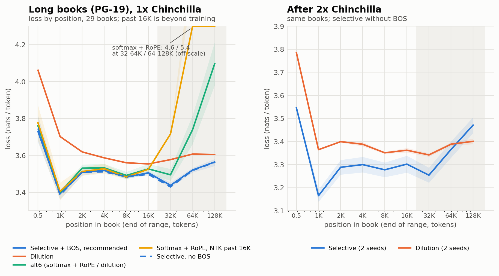
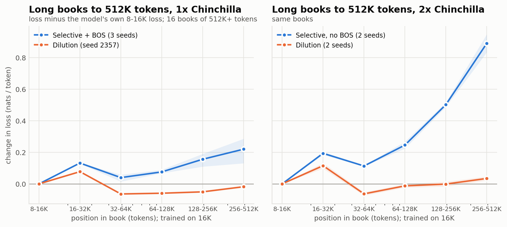
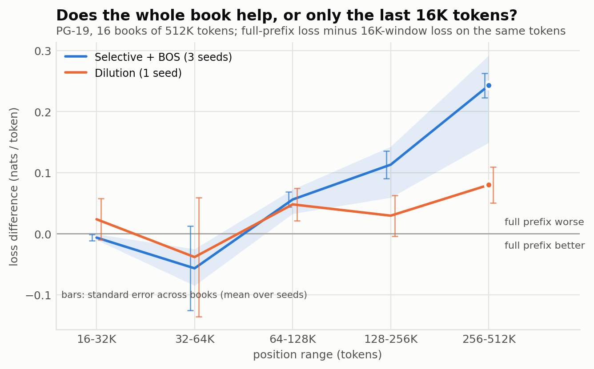
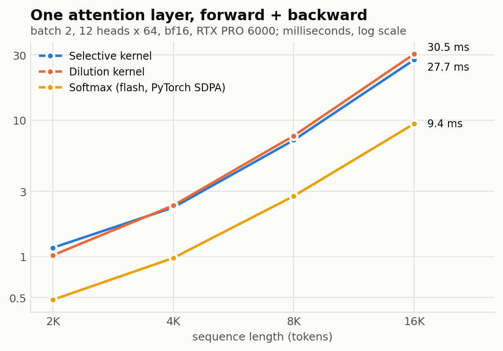

# Selective-Attention-Study

A study of **Selective Attention** (Leviathan, Kalman and Matias, "Selective Attention Improves
Transformer", ICLR 2025, [arXiv:2410.02703](https://arxiv.org/abs/2410.02703)) trained the way
[Dilution-Attention](https://github.com/Royer-Research-Labs/Dilution-Attention) was: 209M parameters,
16K-token context, the same harness, data and schedule, so its results sit directly beside the
published dilution and softmax runs.

It came out of the Dilution-Attention research. Selective Attention was the nearest published method
we found while reviewing related work, it behaved interestingly in small experiments, and to train it
at 16K we had to write a fused kernel for it. This repository is that comparison, the kernel that made
it possible, and what we learned along the way.

What it offers on its own:
- **A differentiable fused kernel** for the operator (forward and full backward, tested against the
  paper's listing), which makes 16K training practical.
- **A question the paper did not test.** Its experiments used learned position embeddings; here the
  operator is trained with no position encoding at 16K and evaluated far beyond that.
- **A practical training lesson and informative failures:** a start-of-window retrieval failure that
  a BOS token largely removes, and long-document and continued-training results where the operator
  does worse than its retrieval scores suggest.

**Status:** research code, published as-is. It reproduces the results below on the hardware it was
tested on; it is not a maintained library and is not on PyPI. Issues are welcome, but there is no
support commitment. This is an independent implementation, not affiliated with or endorsed by the
paper's authors.

## How this came about

Dilution attention subtracts, from each attention logit, a term that grows with what *earlier
queries* did with the same key. Reviewing related work, we found that Selective Attention has the same
shape: it subtracts a running sum of how strongly earlier queries "selected" each key. We added it to
our experiments as a baseline, and in small-scale experiments (2K training context, no position
encoding; not part of this repository) it behaved much like dilution attention, with no position
signal at all.

That was worth testing at the scale the dilution results were measured at. The paper's listing builds
the full (T x T) attention matrix, which does not fit a 24-layer model at 16K tokens, so we wrote fused
Triton kernels that compute the same operator without it ([The kernel](#the-kernel)). With those it
trains at about dilution's speed (36K against 32K tokens/s) on the unchanged Dilution-Attention
harness, and the published softmax and dilution runs serve as the comparison without being re-run.

## Findings

All at 208.5M parameters, 16,384-token training context, 4.19B tokens (1x Chinchilla), no position
encoding unless stated; three seeds for Selective Attention, two for each published reference.

- **Train it with a BOS token at the start of every window.** The paper exempts `<BOS>` (position 0)
  from selection. Our token stream, like many, has no BOS at window starts, and without one two of
  three models could not retrieve a fact placed in the first few tokens of their input (2/7 and 1/7
  placements correct; the third seed was unaffected). With a BOS token those two seeds score 7/7 and
  6/7, so BOS substantially reduces the failure; in-context and long-book loss are unchanged, and
  past 256K retrieval varies by seed with or without BOS. [Details](#bos-and-the-start-of-window-failure).
- **In context it matches dilution attention and edges out softmax with RoPE at equal tokens.**
  Validation loss 3.059 (mean of 3 seeds) against 3.056 for dilution, 3.083 for softmax + RoPE and
  3.039 for the alt6 hybrid. Against softmax + RoPE that is about 2.4% lower perplexity on the same
  tokens, at roughly half the training throughput: evidence under a shared recipe, not an
  equal-compute advantage. With BOS, retrieval is 1.00 from 3,840 to 16K tokens on every seed.
- **Past its training length it keeps retrieving, less reliably on natural text.** With no position
  encoding at all, retrieval on the standard test is 0.99-1.00 to 128K (8x) on all three seeds,
  0.87-1.00 at 256K, and seed-dependent beyond (0.20-0.97 at 512K). With natural text instead of a
  repeated filler paragraph it starts to fall at 2-4x and is 0.30-0.83 at 128K (dilution 0.67, one
  seed; softmax + RoPE at chance from 2x). [Details](#harder-retrieval-natural-text-and-distractors).
  On long books (PG-19) its loss is at or below every reference model's in
  every position range to 128K, by a clear margin past 16K. Past 128K it rises (0.13-0.29 nats above
  its in-window loss by 256-512K) while dilution's stays nearly flat. Neither model uses the distant
  text to predict better: against a 16K rolling window on the same tokens, the whole book helps only
  1-2x back, and past 4x it hurts, by up to 0.29 nats for selective and 0.08 for dilution (one seed)
  at 16-32x. [Details](#does-distant-context-help).
- **Telling facts apart is weak for every model at this scale.** With three similar facts about other
  keys planted beside the target, every operator scores 0.24-0.46 inside 16K, and almost every miss is
  one of the other facts. Selective and dilution attention hold that level to 128K; softmax + RoPE
  falls to chance past 16K.
- **More training shortens that range more than it does for dilution** (tested on the no-BOS recipe
  only; a BOS-trained continuation has not been run). Continued to 2x Chinchilla, one seed kept 1.00
  retrieval to 128K and one fell to 0.31 there, as dilution's seeds also split. On long books the
  difference is clear: at 2x selective's loss climbs 0.5 nats by 128-256K and
  0.8-0.95 by 256-512K, while dilution's stays within 0.05 of its 8-16K value from 64K to 512K.
- **Training it at this scale needed a kernel, and it costs what dilution costs.** The fused
  kernels run a layer in 0.91x the dilution kernel's time with half its memory (2.9x flash softmax
  attention); a 16K training step runs at about half softmax's throughput.



*Needle retrieval from 3,840 to 512,000 tokens for models trained at 16,384. Lines are means over
seeds, bands the seed range. The RoPE models are evaluated unscaled (NTK scaling extends them somewhat; see
Dilution-Attention). Softmax + RoPE falls to chance just past its training length and the alt6 hybrid
by 64K; dilution and Selective Attention keep retrieving, and past 256K every model
depends on its seed. Figures are built from the result files by `scripts/make_figures.py`.*

## The operator

```
L_h[i, j] = q_h[i] . k_h[j] / sqrt(d)                    # every head h, key j <= query i
S[i, j]   = relu(L_0[i, j])     for 1 <= j < i, else 0   # head 0 only; not <BOS>, not self
F[i, j]   = sum over r < i of S[r, j]                    # selection by strictly earlier queries
A_h       = causal_softmax(L_h - F);   out_h = A_h @ v_h
```

No parameters are added. The plain fp32 reference is
[`selective_attention.kernels.selective_attention_reference`](src/selective_attention/kernels.py),
which follows the listing in the paper; the kernels are tested against it for the forward pass and
the full gradient (`tests/test_selective_kernels.py`).

Position 0 is exempt from selection because the paper assumes it holds `<BOS>`. **Make it so**: put
a BOS token at the start of every training and evaluation sequence (in this repository,
`data.bos_token` in the config; see [BOS and the start-of-window failure](#bos-and-the-start-of-window-failure)).

Dilution attention has the same shape. Written on the logits it is `softmax(L_h - F_h)` with
`F_h[i, j] = log(sum over r <= i of p_h[r, j])`, `p` the ordinary causal softmax. The two differ in
what is accumulated (a relu'd raw logit, or a normalised bid), how it is subtracted (linearly, or
as a log), and whose history is used (head 0's for every head, or each head's own).

## Results at 16K

One model (24 layers, d 768, 12 heads, 208.5M parameters), one corpus (FineWeb-Edu, 40B tokens,
GPT-2 tokenizer), one schedule (65,536 tokens per step, learning rate 6e-4, a 128,174-step cosine
evaluated at step 64,000 = 4.19B tokens), 16,384-token training context. The softmax, dilution and
alt6 rows are the published Dilution-Attention results; the Selective Attention rows are trained here
with the same harness (see below) and the same config apart from the operator and, for the
recommended rows, the BOS token. The reference models were trained without a BOS token, which they do
not need: neither shows the blind spot, and a BOS changes Selective Attention's loss by less than the
seed spread.

<!-- RESULTS -->
Loss: common 2.1M-token validation slice at step 64,000 (`results/eval`). NIAH: accuracy over 7
scored needles x 20 placements inside the trained context, x 10 past it; chance is 0.14. Columns
are input lengths in tokens (filler, needle and question); "-" = not measured. Generated by
`scripts/compare_16k.py` (`results/table_16k.md`).

| model | seed | loss | 3840 | 7936 | 12K | 16K | 24K | 32K | 48K | 64K | 96K | 128K | 192K | 256K | 384K | 512K |
|---|---|---|---|---|---|---|---|---|---|---|---|---|---|---|---|---|
| softmax + RoPE | 1337 | 3.0883 | 1.00 | 0.99 | 0.92 | 0.79 | 0.17 | 0.14 | 0.14 | 0.14 | - | - | - | - | - | - |
| softmax + RoPE | 2357 | 3.0787 | 0.97 | 0.96 | 0.79 | 0.64 | 0.19 | 0.14 | 0.14 | 0.14 | - | - | - | - | - | - |
| softmax, no position | 1337 | 3.2118 | 0.46 | 0.29 | 0.23 | 0.19 | 0.11 | 0.13 | 0.14 | 0.14 | 0.14 | 0.14 | 0.14 | 0.14 | - | - |
| softmax, no position | 2357 | 3.2907 | 0.42 | 0.28 | 0.20 | 0.17 | 0.14 | 0.14 | 0.14 | 0.14 | 0.14 | 0.14 | 0.14 | 0.14 | - | - |
| dilution, no position | 1337 | 3.0569 | 1.00 | 1.00 | 1.00 | 1.00 | 0.99 | 0.96 | 0.97 | 0.99 | 0.99 | 0.96 | 0.80 | 0.63 | - | - |
| dilution, no position | 2357 | 3.0548 | 1.00 | 1.00 | 1.00 | 1.00 | 1.00 | 1.00 | 1.00 | 1.00 | 1.00 | 0.91 | 0.91 | 0.79 | - | - |
| alt6 (softmax + RoPE / dilution layers) | 1337 | 3.0385 | 1.00 | 1.00 | 1.00 | 1.00 | 0.96 | 0.29 | 0.17 | 0.16 | - | - | - | - | - | - |
| alt6 (softmax + RoPE / dilution layers) | 2357 | 3.0399 | 1.00 | 1.00 | 1.00 | 1.00 | 1.00 | 0.91 | 0.44 | 0.14 | - | - | - | - | - | - |
| selective + BOS, no position (recommended) | 1337 | 3.0594 | 1.00 | 1.00 | 1.00 | 1.00 | 1.00 | 1.00 | 1.00 | 1.00 | 1.00 | 1.00 | 1.00 | 1.00 | 1.00 | 0.97 |
| selective + BOS, no position (recommended) | 2357 | 3.0520 | 1.00 | 1.00 | 1.00 | 1.00 | 1.00 | 1.00 | 1.00 | 1.00 | 1.00 | 1.00 | 0.97 | 0.87 | 0.71 | 0.40 |
| selective + BOS, no position (recommended) | 7331 | 3.0651 | 1.00 | 1.00 | 1.00 | 1.00 | 1.00 | 1.00 | 1.00 | 1.00 | 1.00 | 0.99 | 0.94 | 0.89 | 0.39 | 0.20 |
| selective, no position, no BOS | 1337 | 3.0573 | 1.00 | 1.00 | 1.00 | 1.00 | 1.00 | 1.00 | 1.00 | 1.00 | 1.00 | 1.00 | 1.00 | 1.00 | 1.00 | 1.00 |
| selective, no position, no BOS | 2357 | 3.0651 | 0.97 | 0.97 | 0.97 | 0.97 | 0.94 | 0.94 | 0.93 | 0.94 | 0.91 | 0.89 | 0.89 | 0.59 | 0.50 | 0.39 |
| selective, no position, no BOS | 7331 | 3.0689 | 0.96 | 0.96 | 0.96 | 0.96 | 0.91 | 0.91 | 0.91 | 0.91 | 0.91 | 0.91 | 0.91 | 0.90 | 0.86 | 0.80 |
<!-- /RESULTS -->

**What the retrieval test measures.** One fixed paragraph of office text repeated to length, with
"The secret keyword is *w*." planted at an evenly spaced depth; the model's likelihood is compared
across 8 single-token keywords (the harness is [Royer-Research-Labs/Niah](https://github.com/Royer-Research-Labs/Niah)
at `fcc0ffa`; standard-mode scoring is identical from `84a4fed` on). It measures copying one planted token out of repetitive filler, not reasoning or
retrieval from natural text. Results before 2026-10-20 were scored with the harness at `7cbf29f`;
the options added since are off by default and do not change scoring. (Seed 1337's 2x NIAH files
were scored from a checkout of `7cbf29f` with uncommitted local changes, recorded as `dirty` in the
files.)

**Where in the window the loss differs** (`results/position/`, same 128 validation sequences for
every model): Selective Attention (no BOS, seed 1337 as the base) is 0.07 nats better than dilution in
the first 256 tokens, level from 512 to 4K tokens, and 0.004-0.007 worse from 4K to 16K; softmax +
RoPE is 0.02-0.03 worse at every position.

## Harder retrieval: natural text and distractors

The standard test repeats one paragraph and plants one fact, so a model can pass by spotting the only
sentence that breaks the pattern. The Niah harness's hard mode asks the same question under harder
conditions, with the same likelihood scoring and control prior:

- **Natural text.** Each haystack is a contiguous slice of six PG-19 train-split books (7.0M tokens,
  `scripts/investigate/make_niah_filler.py`), from a different seeded offset per placement.
- **Distractors.** Besides the target, three facts of the same form about other keys are planted at
  seeded depths ("The secret keyword for the *Cedar* project is *rain*."). The question names one key,
  and each distractor's keyword is also a scored choice, so a model has to tell the facts apart.



Retrieval accuracy, 8 keywords x 10 depths per length (70 scored placements after the control prior,
so about +/-0.06 per cell). The RoPE models use NTK scaling past 16K.

| no distractors | 4K | 16K | 32K | 64K | 128K |
|---|---|---|---|---|---|
| selective + BOS, 3 seeds | 0.93-1.00 | 0.73-1.00 | 0.54-1.00 | 0.41-0.99 | 0.30-0.83 |
| dilution, seed 2357 | 0.99 | 0.96 | 0.91 | 0.86 | 0.67 |
| softmax + RoPE, 2 seeds | 0.97-0.99 | 0.50-0.59 | 0.13-0.17 | 0.11-0.14 | 0.11-0.16 |

| 3 distractors: accuracy (share answered with a distractor's keyword) | 4K | 16K | 32K | 64K | 128K |
|---|---|---|---|---|---|
| selective + BOS, 3 seeds | 0.30-0.40 (0.56-0.70) | 0.34-0.46 (0.54-0.64) | 0.39-0.44 (0.53-0.59) | 0.27-0.43 (0.49-0.56) | 0.29-0.43 (0.40-0.50) |
| dilution, seed 2357 | 0.26 (0.69) | 0.36 (0.59) | 0.36 (0.57) | 0.34 (0.54) | 0.37 (0.50) |
| softmax + RoPE, 2 seeds | 0.30-0.34 (0.60-0.70) | 0.24-0.36 (0.56-0.74) | 0.19-0.21 (0.34-0.41) | 0.17-0.20 (0.30-0.39) | 0.19-0.20 (0.31) |

What this adds to the standard test:

- **Inside 16K, natural text is no harder for the position-free operators** (two selective seeds and
  dilution at 0.96-1.00), and they retrieve evenly at every depth. Softmax + RoPE trained on the same
  recipe has a recency bias: 0.50-0.64 for facts in the first half of the input, 0.79-1.00 near the end.
- **Past 16K, natural text costs retrieval.** Repeated filler kept every selective seed at 0.99-1.00 to
  128K; natural text brings them to 0.30-0.83 there, with a wide spread between seeds (seed 7331 is
  already at 0.73 at 16K). Dilution's single seed declines more gently. Past the training length the
  selective models keep facts at the very start and end of the input and lose the middle first.
- **Telling similar facts apart is the bottleneck for every model.** With three distractors all
  operators sit between 0.24 and 0.46 inside 16K, and most misses are a distractor's keyword: the models
  find the planted facts but often attach the wrong one to the key. Picking a planted fact at random
  would score about 0.25. The position-free operators keep this level to 128K; RoPE falls toward
  chance past 16K, and its misses there are no longer mostly distractors.

`scripts/investigate/niah_hard.py`; `results/investigate/niah_hard_d0.json` (no distractors) and
`niah_hard_d3.json` (three), with every placement recorded. The files record the harness as `7ec932f`
with uncommitted changes; those changes are exactly commit `fcc0ffa`.

## BOS and the start-of-window failure

Two of the three models trained without a BOS token have a blind spot: a needle placed as the very
first sentence of the input (depth 0) is missed, at every input length, while every other depth
is retrieved. The third seed does not show it. A BOS token at the start of every training window
substantially reduces it: the two affected seeds go from 2/7 and 1/7 to 7/7 and 6/7.



| seed | depth-0 placements correct, 256 / 1,920 tokens: no BOS | with BOS | loss: no BOS | with BOS |
|---|---|---|---|---|
| 1337 | 7/7, 7/7 | 7/7, 7/7 | 3.0573 | 3.0594 |
| 2357 | 2/7, 3/7 | 7/7, 7/7 | 3.0651 | 3.0520 |
| 7331 | 1/7, 1/7 | 6/7, 6/7 | 3.0689 | 3.0651 |

Why (`scripts/investigate/niah_investigate.py`, `results/investigate/early_needles*.json`): Selective Attention exempts only
position 0 from selection. Windows cut from a token stream start mid-document, so position 0 is an
arbitrary token, and some models come to treat the first few real tokens as attention sinks. In seed
2357 the three layers that do the retrieval (8, 16, 21) had accumulated a selection of 760-2,900 on a start-position
answer token (against 0 for the same token five percent into the text), which suppresses it for every
head. In seed 7331 the retrieval layer applied no suppression but did not attend to the token; the
failure there is upstream. One ordinary sentence placed before the needle restores 7/7 in all three
models, while a bare `<|endoftext|>` does not help models that were not trained with one
(`scripts/investigate/niah_prefix_test.py`, `results/investigate/niah_prefix_test.json`). We did not
see the blind spot in separate small-scale experiments at 2K context, so a short-context screen may
not catch it.

The fix costs nothing measurable: mean loss 3.059 with BOS against 3.064 without, retrieval to 128K
0.99-1.00 on every BOS seed, and long-book perplexity unchanged (below). Past 256K the seeds differ
with or without BOS.

## Long documents (PG-19)

Loss in nats per token by position, teacher-forced over the first 131,072 tokens of the 29 PG-19
books that long (`scripts/long_perplexity.py`, the Dilution-Attention protocol; `results/longppl/`).
Positions past 16,384 are beyond the training length; RoPE models use NTK scaling there.



**Out to 512K tokens.** The PG-19 test and validation splits have only 3 books of 512K tokens, so
this test uses 16 such books from the PG-19 train split (`scripts/prepare_pg19_long.py`; none of the
models trained on PG-19). Per-book differences are paired, so the standard errors below are across
books for the same text.



| selective minus dilution, nats | 8-16K | 32-64K | 64-128K | 128-256K | 256-512K |
|---|---|---|---|---|---|
| 1x: selective + BOS (3 seeds) vs dilution (seed 2357) | -0.12 to -0.17 | -0.02 to -0.06 | -0.02 to +0.00 | +0.04 to +0.08 | +0.02 to +0.14 |
| 2x: selective vs dilution, same seed (2 seeds) | -0.12 / -0.17 | +0.05 / +0.02 | +0.15 / +0.08 | +0.38 / +0.34 | +0.67 / +0.76 |

Standard errors are 0.02-0.05 for the 1x rows past 32K and 0.02-0.09 for the 2x rows
(`results/longppl/pg19long_*.json`). Dilution's loss is flat to 32x its training length at both 1x
and 2x; Selective Attention's grows slowly past 8x at 1x and steeply after further training.

| model, 1x | 8K-16K | 16K-32K | 32K-64K | 64K-128K |
|---|---|---|---|---|
| selective + BOS (3 seeds) | 3.49-3.52 | 3.43-3.45 | 3.51-3.53 | 3.54-3.58 |
| selective, no BOS (3 seeds) | 3.48-3.52 | 3.41-3.46 | 3.50-3.55 | 3.53-3.59 |
| dilution (seed 2357) | 3.554 | 3.577 | 3.607 | 3.605 |
| alt6 (2 seeds) | 3.50-3.55 | 3.46-3.53 | 3.66-3.82 | 3.98-4.21 |
| softmax + RoPE (2 seeds) | 3.51-3.54 | 3.71-3.72 | 4.52-4.68 | 5.34-5.54 |
| softmax, no position (seed 2357) | 3.820 | 3.978 | 5.544 | 6.203 |

### Does distant context help?

The curves above show that the models tolerate long inputs, not that they use them. A control scores
the same target tokens twice: once with the whole book so far, and once with a 16K rolling window
(windows of 16,384 tokens every 4,096 tokens, so each token sees 12-16K of context; BOS-trained models
get BOS at the start of every window) (`scripts/investigate/rolling_window.py`).



| full prefix minus 16K window, nats/token (negative: the distant text helped) | 16-32K | 32-64K | 64-128K | 128-256K | 256-512K |
|---|---|---|---|---|---|
| selective + BOS, 3 seeds, 29 books to 131K | -0.003 to -0.010 | -0.006 to +0.007 | +0.012 to +0.036 | | |
| dilution, seed 2357, 29 books to 131K | +0.003 | +0.019 | +0.036 | | |
| selective + BOS, 3 seeds, 16 books to 512K | -0.001 to -0.010 | -0.03 to -0.09 | +0.033 to +0.073 | +0.059 to +0.143 | +0.149 to +0.292 |
| dilution, seed 2357, 16 books to 512K | +0.024 | -0.04 | +0.048 | +0.030 | +0.080 |

Standard errors across books: 0.002-0.006 for selective at 16-32K and 0.003-0.025 past 64K; 0.008-0.034
for dilution; 0.05-0.10 for every model in the 32-64K column of the 512K set, where a few books dominate.

- **Selective Attention gains a little from the text 1-2x back** (on 27 of 29 books for seed 1337), is
  neutral at 2-4x, and from 4x on the extra text hurts on nearly every book. Past 64K it would predict
  these books better from its last 16K tokens than from everything before them.
- **Dilution does not gain either.** On a typical book it is about neutral (its median per-book
  difference is about zero to 131K; the mean there is pulled up by two books), and at 512K the harm is
  about a third of selective's. That is what "flat" means for dilution here: it tolerates the distant
  text more stably, not that it uses it.
- **Selective's lower loss on these books is in-window quality.** With the same 16K window it is still
  about 0.1 nats better than dilution on the 131K books (3.44-3.46 against 3.57 at 16-32K; 0.04-0.08 on
  the 512K books).
- **Text difficulty.** On the 131K set, the window loss itself rises about 0.1 nats from 16-32K to
  64-128K, so most of the full-prefix rise there is the text getting harder. On the 512K set the window
  loss is flat, so the rise past 128K there is the model.

Results: `results/investigate/rolling_window_16k_1x.json` (131K) and `rolling_window_512k_1x.json`
(512K), with every book recorded. The softmax + RoPE entries in the 131K file applied NTK scaling to
the whole full-prefix pass, which also damages in-window positions, so they do not measure context use.

## More training (2x Chinchilla)

Two seeds without BOS were continued along the same cosine to its end (8.40B tokens):

| | loss | NIAH 64K | 128K | 192K | 256K | PG-19 8K-16K | 64K-128K |
|---|---|---|---|---|---|---|---|
| selective, seed 1337 | 2.855 | 1.00 | 1.00 | 0.99 | 0.96 | 3.339 | 3.506 |
| selective, seed 2357 | 2.863 | 0.90 | 0.31 | 0.14 | 0.20 | 3.265 | 3.437 |
| dilution, seeds 1337 / 2357 | 2.857 / 2.854 | 0.54 / 0.97 | 0.29 / 0.83 | 0.23 / 0.77 | 0.23 / 0.67 | 3.37 / 3.35 | 3.41 / 3.39 |

Loss improves identically to dilution's. Extrapolation past about 8x survives further training in one
seed and not the other, as it did for dilution (Dilution-Attention `docs/signals.md`, S19 and S24), and long-book loss past
32K rises more than dilution's, which stays flat.

The obvious suspect is the history term `F`, a running sum that keeps growing with position. It does
grow linearly, from inside the training window onward (its 99th percentile goes from about 7,000 at
8-16K to 60,000 at 64-128K), but attention does not change with it: averaged over layers, normalised
entropy (entropy / log(i + 1)) and peak weight stay within a few percent of their in-window values out
to 128K, at 1x and at 2x (individual layers move more)
(`scripts/investigate/history_probe.py`, `results/investigate/history_probe.json`). Damping `F` past the trained
length at evaluation time (scaling it by 16K / position, or its square root) makes long-book loss and
retrieval worse, not better (`scripts/investigate/history_damp_eval.py`; `results/investigate/damp_*`,
`results/longppl/pg19_damp_*`). Neither tested damping scheme rescued the degradation; damping at
evaluation time could also disrupt something the model learned to compensate for, so this does not
rule the history term out. The cause remains unresolved.

## Limitations

- One model size, one corpus, one context length; three seeds per Selective Attention design.
- The retrieval tests are synthetic: one planted keyword, in a repeated paragraph or in natural text
  with distractors; retrieval past 16K varies by seed.
- The context-use control covers PG-19 books only, and one dilution seed.
- The continued-training (2x) runs are without BOS; the recommended recipe has not been continued.
- Only one GPU architecture tested; decoding is not a kernel; the code is not maintained.
- The Forgetting Transformer and stick-breaking attention also train without position encoding and
  extrapolate; they were not run at this scale.

## The kernel

The kernels exist to make the comparison above possible; they are tested, documented and
reproducible, but provided as-is (see Status).

```python
from selective_attention import selective_attention

out = selective_attention(q, k, v)        # q, k, v: (B, H, T, D) on CUDA; returns fp32 (B, H, T, D)
```

`selective_attention` is differentiable (a fused forward and a fused backward).
`selective_attention_forward` is the forward alone and can return the per-key selection totals that
cached decoding carries. Requirements: PyTorch 2.4+ with CUDA and Triton; fp16, bf16 or fp32 inputs
with `D` in 16, 32, 64, 128 (anything else raises a `ValueError`). For bf16 inputs the dot products
use bf16 tensor-core operands with fp32 accumulation, otherwise TF32 (`dot_precision="ieee"` for
exact fp32); the selection sum and the softmax are always fp32. `exempt=N` exempts the first N
positions from selection (default 1, the paper).

The sequence length is a compile-time constant, so each new length compiles its kernels once (a few
seconds). The only scratch buffer is T²/8 bytes per sequence (32 MiB at 16K, 32 GiB at 512K), which
is what limits the length. How the kernels work: [docs/kernel.md](docs/kernel.md). Cached decoding is
written in PyTorch, not as a kernel.

Tested on one GPU, an RTX PRO 6000 Blackwell (sm_120), with PyTorch 2.13 and Triton 3.7.

### Cost

One attention layer, forward + backward, batch 2, 12 heads of 64 dimensions, bf16 inputs
(`scripts/bench_kernels.py`):

<!-- BENCH -->
| context | softmax | dilution kernel | selective kernel | peak memory (softmax / dilution / selective) |
|---|---|---|---|---|
| 2,048 | 0.48 ms | 1.02 ms | 1.16 ms | 0.08 / 0.11 / 0.09 GiB |
| 4,096 | 0.98 ms | 2.37 ms | 2.29 ms | 0.15 / 0.25 / 0.18 GiB |
| 8,192 | 2.78 ms | 7.68 ms | 7.14 ms | 0.31 / 0.59 / 0.38 GiB |
| 16,384 | 9.41 ms | 30.50 ms | 27.69 ms | 0.61 / 1.55 / 0.79 GiB |

Measured on an idle GPU, 20 repetitions (`results/bench/layer_fwd_bwd_v2.json`). At 16K the
selective kernel takes 2.9x the time of flash softmax attention and 0.91x the dilution kernel, with
half the dilution kernel's memory. Version 1 of the kernel took 33.38 ms at 16K
(`results/bench/layer_fwd_bwd_v1.json`); see "Kernel versions" below.
<!-- /BENCH -->



"softmax" is PyTorch's `scaled_dot_product_attention` with `is_causal=True`. For the whole 209M model
at 16K, a training step runs at 36K tokens/s with the selective kernel, against 72K for softmax +
RoPE and 32K for dilution in the Dilution-Attention runs: at equal wall clock softmax sees about
twice the tokens. The comparisons above are at equal tokens.

### Kernel versions

| version | file | SHA-256 | 16K layer time | trained |
|---|---|---|---|---|
| 1 (2026-10-11) | `src/selective_attention/kernels_v1.py` | `3d323daf95781a0b85c2ce9160b89d6fcae5bfeb51025d1781112fbc5045f73e` | 33.4 ms | seeds 1337, 2357 (no BOS), first halves of both 2x runs |
| 2 (2026-10-16) | `src/selective_attention/kernels.py` | this release | 27.7 ms | seed 7331 (no BOS), all three BOS seeds, second halves of both 2x runs |

Both compute the same operator and pass the same parity tests against the reference; version 2
shares head 0's selection work between heads (docs/kernel.md, "Head groups") and so sums in a
different order. `kernels.selective_attention(..., group=1, bwd_group=1)` runs the version-1 launch
layout; `tests/test_selective_kernels.py` checks both against `kernels_v1.py` in bf16. Changes to
version 2 since training leave the default computation unchanged: `exempt` (2026-10-19), the
evaluation-only history damping (2026-10-26), and for this release input checks, one precision rule
for both entry points, 64-bit statistic offsets, and the removal of slower experimental backward
variants (2026-10-26).

## Reproducing

```bash
pip install -e ".[dev,data,niah,plots]"     # plots: matplotlib, for scripts/make_figures.py
pytest                                   # CPU tests + CUDA-gated kernel parity
python scripts/check_vendored.py         # the harness files match the recorded Dilution-Attention commit
python -m selective_attention.train --config configs/smoke_selective.yaml --overwrite-run   # CPU, seconds
```

The kernel tests need a CUDA GPU and are skipped without one; on CPU the reference and model tests
run.

Data (the corpus the Dilution-Attention 209M runs used; rebuilds exactly):

```bash
selective-attention-prepare-data --dataset HuggingFaceFW/fineweb-edu --dataset-config sample-100BT \
    --revision fc9850dff5e2d0f8f776efe41b24a1c49556cfc5 \
    --train-tokens 40000000000 --val-tokens 20000000 --output-dir data/fineweb_edu_100bt_40b
```

Training (the recommended BOS recipe), loss on the common validation slice, and retrieval. The
published run records are in `runs/scale_16384/` and the results in `results/`; a reproduction writes
to separate directories (`runs_repro/`, `results_repro/`, both git-ignored) so it never collides with
them:

```bash
selective-attention-train --config configs/scale_16384/all_selective_nope_bos.yaml --seed 1337 \
    --output-dir runs_repro/scale_16384/all_selective_nope_bos_seed1337 --stop-at-step 64000
python scripts/eval_checkpoint.py runs_repro/scale_16384/all_selective_nope_bos_seed1337 \
    --output results_repro/eval/scale1x__all_selective_nope_bos_seed1337.json
git clone https://github.com/Royer-Research-Labs/Niah ../Niah && git -C ../Niah checkout fcc0ffa
selective-attention-niah --checkpoint runs_repro/scale_16384/all_selective_nope_bos_seed1337/latest.pt \
    --context-length 1024 1920 3840 7936 12288 16000 --samples 20 --num-needles 8 \
    --output results_repro/niah/scale1x__all_selective_nope_bos_seed1337.json
```

The NIAH harness is found at `../Niah`, or wherever `DILUTION_NIAH_ROOT` points.
`scripts/run_16k.sh` runs a seed through training, loss and NIAH to 256K (the BOS recipe by default;
`ARM=all_selective_nope` for the model without BOS), into `runs_repro/` and `results_repro/`. The 384K / 512K NIAH and the PG-19 tests are
run separately with `selective-attention-niah --context-override` and `scripts/long_perplexity.py`.
Hard mode needs the PG-19 train-split books (`scripts/prepare_pg19_long.py`, written to
`data/pg19_long`), then `python scripts/investigate/make_niah_filler.py --data data/pg19_long --books 6
--output data/niah_filler/pg19_train6.txt` and `scripts/investigate/niah_hard.py` with
`--distractors 0` or `3` (its docstring has the full command).
`scripts/compare_16k.py` rebuilds the results table and `scripts/make_figures.py` the figures, from
`results/` and the published Dilution-Attention results copied into `results/reference/`
(`SOURCE.json` records the source commit and hashes).

## What is copied from Dilution-Attention

The training harness in `src/selective_attention/` (config, model, trainer, data, evaluation, the
retrieval bridge, and the dilution kernels as `dilution_kernels.py`) and six scripts are copied from
Dilution-Attention at commit `144cb2d`. Most files are byte-identical; the others differ in import
lines, because the package has a different name, and four carry an opt-in option added on
2026-10-19, `data.bos_token`, which starts every training and evaluation window with a fixed token
(NIAH prompts and PG-19 books get the same token). It is inactive unless a config sets it, so the
published runs and the configs that reproduce them are unaffected. `dilution_kernels.py` also widens
its scratch-buffer offsets to 64 bits: the source overflows int32 past about 262K tokens, and the
512K dilution rows above depend on the fix. `vendored.json` records every
file's source hash and every edit, and `scripts/check_vendored.py` verifies that undoing the edits
reproduces the source exactly.

Three files are new: [`kernels.py`](src/selective_attention/kernels.py), the Selective Attention
kernels; [`kernels_v1.py`](src/selective_attention/kernels_v1.py), version 1, kept frozen; and
[`mixers.py`](src/selective_attention/mixers.py), which registers
`attention: selective` through an extension point the harness already had. So the trainer,
schedule, data order, evaluation slice and retrieval test are the ones that produced the published
softmax and dilution numbers, and those runs are not repeated here.

## Licence

Apache-2.0. See [NOTICE](NOTICE).
